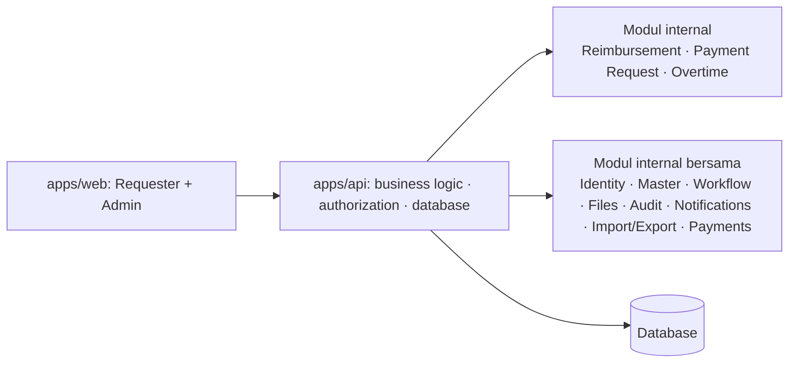

# Platform Pengajuan Internal — Product Requirements Document

**Versi:** 0.5 · **Status:** Draft review · **Tanggal draft awal:** 2026-10-29
**Sumber dokumentasi:** keputusan discovery. Header terdahulu juga mencantumkan `screenshot-2026-10-27_12-54-41.pdf` dan `prototype/checkpoint-v0.html`; kedua file itu tidak ada pada pohon repo yang diperiksa.

> ID lama FR/AC/PG dipertahankan jika masih relevan. Prototype bukan sumber keputusan baru.

## 1. Overview

### Masalah dan tujuan

Pengajuan reimbursement, payment request, dan overtime tersebar di chat, spreadsheet, file, dan e-banking manual. Finance sulit memeriksa kelengkapan, approval tidak transparan, bukti dan perubahan sulit diaudit, serta kategori/project dapat salah.

Produk menyediakan satu backend modular dan tiga layanan: **Reimbursement**, **Payment Request**, dan **Overtime**. Produk mengatur akses, form kontekstual, bukti, Finance review, approval satu orang, persiapan/rilis pembayaran manual, status, notifikasi, audit trail, wardrobe reference, import master, dan export.

### Pengguna dan hak

- **Requester:** membuat layanan yang diaktifkan Admin, upload/link bukti, melihat pengajuan sendiri, mengubah field yang ditandai saat Revision.
- **Admin:** mengelola user, master data, konfigurasi, seluruh review dan proses organisasi.
- **Admin + Can approve:** Approve atau Return to Admin.
- **Admin + Can make payment:** menyiapkan transaksi.
- **Admin + Can release payment:** merilis/menandai Paid sesuai aturan.
- **Admin + Can view wardrobe:** mencari wardrobe reference.

Hanya dua user type. Hak tambahan bukan kategori user ketiga.

### Konteks dan ukuran keberhasilan

Admin memakai desktop/laptop; Requester dapat memakai HP. MVP tidak terintegrasi langsung dengan bank, e-banking, ERP, atau akuntansi. Baseline yang dikumpulkan: persentase pengajuan melalui sistem, kelengkapan pada review pertama, waktu menuju review Finance, pertanyaan status melalui chat, dan pengajuan yang terlacak sampai Paid. Target angka ditetapkan setelah uji coba.

### Scope

MVP: multi-organisasi terisolasi; invited email/password dan Google login; tiga layanan; akses configurable; draft autosave/Save Draft 90 hari; review, Revision, Reject, Cancelled, approval satu Approver, Maker/Release/Paid; OCR pihak ketiga dengan fallback manual; wardrobe reference; import master per file; export CSV/Excel/PDF; audit dan in-app notification.

Di luar MVP: integrasi langsung, multi-approval, portal vendor, PPM lengkap, wardrobe lending, email/WhatsApp, self-registration organisasi, import transaksi historis.

## 2. Requirements

### 2.1 Access, organization, ownership

- **FR-001–011:** Pengelola sistem membuat organisasi dan Admin pertama; Admin mengundang user; email Google harus sudah diundang; user nonaktif tidak dapat login/membuat baru; data tenant terpisah; satu akun satu organisasi.
- Admin mengatur akses tiga layanan dan permissions `Can approve`, `Can make payment`, `Can release payment`, `Can view wardrobe`.
- Perubahan akses berlaku untuk pengajuan baru. Pengajuan lama tetap terlihat dan ditindaklanjuti sampai selesai.
- Data transaksi dimiliki organisasi; Requester memiliki pengajuan buatan sendiri; master dikelola Admin.

### 2.2 Shared workflow/status

Alur default: `Requester → Admin/Finance review → Approver → Maker → Release → Paid`.

Status: `Pending`, `Revision`, `Finance Approved`, `Approved`, `Return to Admin`, `Maker Done`, `Pending vendor proof` (Payment Request only), `Rejected`, `Cancelled`, `Paid`.

- Requester Cancel hanya sebelum Admin mulai memproses.
- Admin dapat Revision dengan field/kelompok field dan instruksi publik; Requester hanya mengubah field tersebut; resubmit kembali ke Finance.
- Admin Reject untuk fraud/pelanggaran/kesalahan serius; wajib alasan; tidak dapat diedit.
- Approver hanya Approve atau Return to Admin; Return wajib alasan; satu Approver.
- Tanpa Approver terkonfigurasi, penerusan ditolak. Admin dapat mengganti Approver manual dengan audit.
- `Finance Approved` berarti validasi Finance selesai, bukan approval bisnis.
- `Maker Done` berarti transaksi disiapkan, belum dirilis. Paid memerlukan tanggal, referensi, bukti pembayaran, dan aturan Maker/Releaser.
- Default Maker dan Releaser: orang berbeda wajib; override per layanan.

### 2.3 Shared functional/nonfunctional requirements

- Form dan data master aktif divalidasi server-side; Principal otomatis dari Brand; snapshot master/tarif/aturan disimpan pada pengajuan.
- Upload: gambar JPG/JPEG/PNG maksimum 10 MB; PDF maksimum 25 MB. Upload gagal tidak menghapus field lain; Submit ditahan jika bukti wajib belum tersimpan.
- Link tidak harus publik; Admin memvalidasi dan menyimpan salinan privat sebelum Finance Approved.
- OCR provider pihak ketiga, prioritas free tier; hasil wajib diperiksa Requester dan divalidasi Admin; gagal/kuota habis otomatis input manual; tidak memblokir Submit.
- KTP/rekening hanya Admin; MOU/Surat Kuasa Admin + Approver terkait; invoice pihak pemroses; bukti pembayaran pihak terkait; catatan publik vs internal terpisah.
- Audit menyimpan status, actor, waktu, field lama/baru, alasan; tidak dapat dihapus.
- Retensi transaksi/invoice/payment proof/audit 7 tahun; data sensitif 5 tahun atau sampai tidak diperlukan; Legal Hold mencegah penghapusan.
- Import preview, validasi, baris valid dapat commit, baris error dilaporkan. Export mengikuti filter/permission.
- Responsive/mobile, keyboard/focus, contrast, error cause/next action, private file storage, tenant isolation, pagination.
### Ticket numbering

Nomor publik pengajuan memakai format ringkas: `REIM-0001` (Reimbursement), `PAY-0001` (Payment Request), dan `OT-0001` (Overtime). Sequence terpisah per organisasi dan layanan. Nomor tidak memuat kode organisasi, tahun, atau status; konteks organisasi berasal dari akun dan `organization_id`. Nomor tidak berubah saat Revision atau status lain. Nomor Cancelled/Rejected tetap terpakai dan tidak diulang. Sistem menyimpan UUID/internal ID terpisah untuk relasi dan keamanan.

## 3. Core Features — fase, fitur, subfitur, task

### Fase 1 — Foundation dan akses

#### F1. Identity & organization
- **Tujuan:** menyediakan akses tenant yang aman.
- **Pengguna:** Pengelola sistem, Admin, Requester.
- **Rentang FR:** FR-001–011.
- **Dependensi:** tidak ada; menjadi dependensi seluruh fitur.

##### SF1.1 User invitation & permissions
- **Deskripsi:** Admin mengundang user dan mengatur user type, akses layanan, serta permission tambahan.
- **Acceptance Criteria:** email tanpa undangan ditolak; user type dan permission tersimpan; perubahan akses berlaku untuk pengajuan baru; pengajuan lama tetap dapat ditindaklanjuti.
- **Layar:** PG-01, PG-11.
- **State penting:** invited, active, disabled, validation error, permission changed.
- **Tasks:** T1.1.1 invite form; T1.1.2 permission editor; T1.1.3 disable-user action; T1.1.4 server authorization check.

##### SF1.2 Login
- **Deskripsi:** login email/password atau Google untuk email yang sudah diundang.
- **Acceptance Criteria:** email invited dapat masuk; user nonaktif ditolak; error menjelaskan tindakan berikutnya.
- **Layar:** PG-01.
- **State penting:** default, invalid credentials, uninvited, disabled, loading.
- **Tasks:** T1.2.1 login form; T1.2.2 Google login callback; T1.2.3 invite lookup; T1.2.4 inactive-user guard.

##### SF1.3 Organization isolation
- **Deskripsi:** semua query, file, export, dan permission dibatasi organization_id.
- **Acceptance Criteria:** tenant lain tidak terbaca; akses server selalu memaksa tenant filter.
- **Layar:** PG-03, PG-11, PG-12.
- **State penting:** authorized, denied, wrong-tenant error.
- **Tasks:** T1.3.1 tenant context middleware; T1.3.2 scoped repository queries; T1.3.3 scoped file URLs; T1.3.4 cross-tenant test.

#### F2. Master data & rules
- **Tujuan:** menjaga konteks, template, tarif, dan aturan workflow.
- **Pengguna:** Admin.
- **Rentang FR:** FR-030–043.
- **Dependensi:** F1.

##### SF2.1 Manage master
- **Deskripsi:** mengelola Entity, Brand, Principal, Quotation, Project/Batch, kategori, role, dan recipient type.
- **Acceptance Criteria:** relasi Brand → Principal → Quotation → Project/Batch konsisten; record lama dinonaktifkan, bukan dihapus.
- **Layar:** PG-12.
- **State penting:** empty, active, inactive, validation error.
- **Tasks:** T2.1.1 master list; T2.1.2 create/edit form; T2.1.3 deactivate action; T2.1.4 relation validation.

##### SF2.2 Configure templates
- **Deskripsi:** mengatur field wajib berdasarkan layanan, Quotation, dan recipient type.
- **Acceptance Criteria:** template baru berlaku untuk request baru; request lama menyimpan snapshot aturan.
- **Layar:** PG-12, PG-14.
- **State penting:** default template, customized, invalid rule.
- **Tasks:** T2.2.1 template editor; T2.2.2 required-field toggle; T2.2.3 rule version snapshot; T2.2.4 effective-rule preview.

##### SF2.3 Configure approval/payment
- **Deskripsi:** mengatur Approver, fallback tarif Overtime, batas minimum, dan aturan Maker/Releaser.
- **Acceptance Criteria:** tanpa Approver request tidak dapat diteruskan; fallback tarif mengikuti urutan; default Maker/Releaser berbeda.
- **Layar:** PG-13, PG-14.
- **State penting:** configured, missing approver, missing rate, invalid rule.
- **Tasks:** T2.3.1 approver assignment; T2.3.2 approver replacement; T2.3.3 rate fallback editor; T2.3.4 maker-release rule editor.

##### SF2.4 Import master
- **Deskripsi:** import satu file per jenis data dengan preview dan hasil per baris.
- **Acceptance Criteria:** preview menampilkan error; baris valid dapat masuk; baris salah dilaporkan.
- **Layar:** PG-12, PG-16.
- **State penting:** upload, preview, partial success, failed.
- **Tasks:** T2.4.1 file upload; T2.4.2 schema validation; T2.4.3 relation/duplicate validation; T2.4.4 commit result report.

### Fase 2 — Requester services

#### F3. Reimbursement
- **Tujuan:** mengajukan satu kategori utama dengan banyak invoice.
- **Pengguna:** Requester, Admin.
- **Rentang FR:** FR-050–069.
- **Dependensi:** F1, F2, F6, shared workflow.

##### SF3.1 New request
- **Deskripsi:** memilih konteks dan satu Cost Category.
- **Acceptance Criteria:** Entity/category wajib; field konteks mengikuti kategori; Principal otomatis dari Brand.
- **Layar:** PG-05.
- **State penting:** blank, draft, validation error, access denied.
- **Tasks:** T3.1.1 context form; T3.1.2 dependent selects; T3.1.3 category rules; T3.1.4 client/server validation.

##### SF3.2 Invoice evidence
- **Deskripsi:** menambahkan invoice, primary proof, additional proof, link, atau OCR/manual data.
- **Acceptance Criteria:** minimal satu invoice dan primary proof; additional proof tidak menambah total; Admin validasi/koreksi dengan audit.
- **Layar:** PG-05, PG-06, PG-17.
- **State penting:** upload, OCR success, OCR failed/manual, upload error, validated.
- **Tasks:** T3.2.1 invoice editor; T3.2.2 primary/additional evidence; T3.2.3 OCR adapter call; T3.2.4 manual fallback; T3.2.5 duplicate warning.

##### SF3.3 Wardrobe proposal
- **Deskripsi:** mengusulkan item Props & Wardrobe secara opsional.
- **Acceptance Criteria:** ukuran wajib untuk Baju/Sepatu/Outer/Kostum; Admin dapat memilih Menunggu Review/Masuk Database/Tidak Masuk Database secara terpisah.
- **Layar:** PG-05, PG-06, PG-15.
- **State penting:** omitted, proposed, awaiting review, approved, excluded.
- **Tasks:** T3.3.1 item fields; T3.3.2 subcategory rules; T3.3.3 admin wardrobe decision; T3.3.4 wardrobe snapshot.

##### SF3.4 Submit/revision/cancel
- **Deskripsi:** submit dengan duplicate confirmation, revision terbatas, dan cancel sebelum diproses.
- **Acceptance Criteria:** `Kirim tetap/Batal`; Revision hanya membuka field ditandai; Cancel hanya Pending sebelum Admin memproses.
- **Layar:** PG-05, PG-06.
- **State penting:** pending, revision, cancelled, rejected, submitted.
- **Tasks:** T3.4.1 submit transition; T3.4.2 duplicate confirmation modal; T3.4.3 revision field unlock; T3.4.4 cancel transition.

#### F4. Payment Request
- **Tujuan:** mengajukan pembayaran satu penerima dalam satu quotation/project context.
- **Pengguna:** Requester, Admin, Approver, Maker, Releaser.
- **Rentang FR:** FR-100–126.
- **Dependensi:** F1, F2, F6, shared workflow.

##### SF4.1 Context/recipient form
- **Deskripsi:** memilih KOL, Talent, atau Freelance dan menampilkan field dari recipient + Quotation.
- **Acceptance Criteria:** satu recipient per request; field wajib mengikuti template aktif.
- **Layar:** PG-07, PG-08.
- **State penting:** recipient variant, missing required field, access denied.
- **Tasks:** T4.1.1 recipient selector; T4.1.2 dynamic field renderer; T4.1.3 quotation rule resolver; T4.1.4 recipient validation.

##### SF4.2 Fee/payment/tax
- **Deskripsi:** Requester mengisi Fee Total; Admin memilih Tax Treatment; sistem menghitung; Admin dapat koreksi dengan alasan.
- **Acceptance Criteria:** Payment Type hanya menampilkan opsi aktif; koreksi menyimpan nilai lama/baru, actor, waktu, alasan.
- **Layar:** PG-07, PG-08, PG-14.
- **State penting:** draft, calculated, admin correction, validation error.
- **Tasks:** T4.2.1 fee/payment fields; T4.2.2 tax rule resolver; T4.2.3 tax calculation; T4.2.4 correction audit.

##### SF4.3 Sensitive profile/documents
- **Deskripsi:** memakai profil KTP/rekening reusable dan dokumen request-specific.
- **Acceptance Criteria:** Requester hanya mengonfirmasi rekening; KTP/rekening hanya Admin; dokumen sesuai permission.
- **Layar:** PG-07, PG-08.
- **State penting:** profile exists, confirmation required, masked, missing document.
- **Tasks:** T4.3.1 recipient profile; T4.3.2 bank confirmation; T4.3.3 sensitive access policy; T4.3.4 document checklist.

##### SF4.4 Vendor proof
- **Deskripsi:** menunggu bukti vendor dan melanjutkan setelah validasi Admin.
- **Acceptance Criteria:** hanya Payment Request memakai status ini; Requester/Admin dapat upload; Admin wajib validasi.
- **Layar:** PG-08, PG-18.
- **State penting:** pending vendor proof, uploaded, validated, invalid.
- **Tasks:** T4.4.1 proof request state; T4.4.2 proof upload; T4.4.3 admin validation; T4.4.4 resume workflow.

#### F5. Overtime
- **Tujuan:** mencatat satu Project/Batch dengan banyak tanggal.
- **Pengguna:** Requester dengan akses, Admin, Approver, Maker, Releaser.
- **Rentang FR:** FR-140–156.
- **Dependensi:** F1, F2, F6, shared workflow.

##### SF5.1 Date entries
- **Deskripsi:** memasukkan tanggal, Clock In/Out, bukti per tanggal atau shared proof.
- **Acceptance Criteria:** satu request satu Project/Batch; durasi dihitung; bukti shared memetakan tanggal.
- **Layar:** PG-09, PG-10.
- **State penting:** blank, calculated, invalid time, missing proof.
- **Tasks:** T5.1.1 entry repeater; T5.1.2 duration calculation; T5.1.3 evidence-date mapping; T5.1.4 time validation.

##### SF5.2 Rate calculation
- **Deskripsi:** memakai fallback Project/Quotation → Role → Entity dan minimum duration.
- **Acceptance Criteria:** tarif paling spesifik dipilih; tanpa tarif Submit ditolak; total menjumlahkan entries.
- **Layar:** PG-09, PG-10, PG-14.
- **State penting:** rate found, rate missing, below minimum, calculated.
- **Tasks:** T5.2.1 rate resolver; T5.2.2 minimum-duration validation; T5.2.3 amount calculation; T5.2.4 no-rate error.

##### SF5.3 Admin correction
- **Deskripsi:** Admin mengubah tarif atau nominal dengan alasan.
- **Acceptance Criteria:** nilai lama/baru, actor, waktu, alasan tersimpan; total dihitung ulang.
- **Layar:** PG-10.
- **State penting:** review, correction form, corrected, audit visible.
- **Tasks:** T5.3.1 correction form; T5.3.2 correction authorization; T5.3.3 recalculate total; T5.3.4 audit event.

#### F6. Drafts and files
- **Tujuan:** menjaga pengisian panjang dan bukti di desktop/HP.
- **Pengguna:** Requester, Admin.
- **Rentang FR:** FR-062–064, FR-190–198, FR-220–228.
- **Dependensi:** F1.

##### SF6.1 Draft
- **Deskripsi:** autosave dan Save Draft, tidak masuk workflow, expired 90 hari.
- **Acceptance Criteria:** draft dapat dilanjutkan; akses dicabut mengunci submit; draft tidak menjadi Pending.
- **Layar:** PG-05, PG-07, PG-09.
- **State penting:** saved, saving, save error, expired, locked.
- **Tasks:** T6.1.1 draft persistence; T6.1.2 autosave indicator; T6.1.3 Save Draft action; T6.1.4 expiry cleanup.

##### SF6.2 Evidence upload
- **Deskripsi:** kamera/galeri/file/link dengan batas format/ukuran dan private access.
- **Acceptance Criteria:** upload error mempertahankan field; link disalin privat sebelum Finance Approved; file lama tidak dihapus saat Revision.
- **Layar:** PG-05, PG-07, PG-09, PG-17.
- **State penting:** upload, processing, success, error, obsolete.
- **Tasks:** T6.2.1 upload control; T6.2.2 file validation; T6.2.3 signed URL; T6.2.4 link-copy validation; T6.2.5 obsolete evidence marker.

### Fase 3 — Finance, approval, payment, visibility

#### F7. Review & approval
- **Tujuan:** memproses request sampai siap/selesai dibayar.
- **Pengguna:** Admin, Approver, Maker, Releaser, Requester.
- **Rentang FR:** FR-170–182.
- **Dependensi:** F1, F2, F3, F4, F5, F6.

##### SF7.1 Finance queue
- **Deskripsi:** Admin melihat antrean/filter/age warning.
- **Acceptance Criteria:** filter service/status/context berfungsi; request detail dapat dibuka.
- **Layar:** PG-03, PG-04.
- **State penting:** loading, empty, filtered, error, overdue.
- **Tasks:** T7.1.1 queue query; T7.1.2 filter controls; T7.1.3 pagination; T7.1.4 age indicator.

##### SF7.2 Decision
- **Deskripsi:** Admin Revision/Reject/Finance Approved; Approver Approve/Return.
- **Acceptance Criteria:** reason wajib sesuai transition; tanpa Approver tidak lanjut; field Revision terbatas.
- **Layar:** PG-06, PG-08, PG-10, PG-13.
- **State penting:** pending, revision modal, rejected, finance approved, return to admin, approved.
- **Tasks:** T7.2.1 revision modal; T7.2.2 reject modal; T7.2.3 finance approval transition; T7.2.4 approver decision; T7.2.5 transition audit.

##### SF7.3 Payment execution
- **Deskripsi:** Maker prepare → Maker Done → Releaser release → Paid.
- **Acceptance Criteria:** bukti/reference/date wajib; same-person rule ditegakkan; Paid tidak boleh tanpa bukti.
- **Layar:** PG-06, PG-08, PG-10.
- **State penting:** approved, maker done, awaiting release, paid, blocked.
- **Tasks:** T7.3.1 maker form; T7.3.2 maker-done transition; T7.3.3 release authorization; T7.3.4 payment proof; T7.3.5 paid transition.

#### F8. Dashboard, notification, export
- **Tujuan:** menampilkan tugas, status, dan hasil export.
- **Pengguna:** Requester, Admin.
- **Rentang FR:** FR-020–026, FR-225–228.
- **Dependensi:** F1, F3, F4, F5, F7.

##### SF8.1 Requester dashboard
- **Deskripsi:** service cards, status counts, attention tasks, recent requests.
- **Acceptance Criteria:** hanya layanan aktif tampil; task Revision/Pending proof terlihat.
- **Layar:** PG-02.
- **State penting:** normal, empty, loading, error, attention.
- **Tasks:** T8.1.1 service cards; T8.1.2 status summary; T8.1.3 attention list; T8.1.4 recent requests.

##### SF8.2 Admin dashboard
- **Deskripsi:** queue, total/status per service, task aging.
- **Acceptance Criteria:** task menunggu tindakan dapat dibuka; age warning terlihat.
- **Layar:** PG-03.
- **State penting:** normal, empty, loading, error, overdue.
- **Tasks:** T8.2.1 queue summary; T8.2.2 service totals; T8.2.3 aging view; T8.2.4 task links.

##### SF8.3 In-app notification
- **Deskripsi:** polling notification untuk submit, revision, approval, reject, return, paid, overdue.
- **Acceptance Criteria:** hanya recipient yang perlu bertindak menerima; unread/read tersimpan.
- **Layar:** PG-18.
- **State penting:** unread, read, empty, polling error.
- **Tasks:** T8.3.1 notification table; T8.3.2 polling endpoint; T8.3.3 unread counter; T8.3.4 deep link.

##### SF8.4 Export
- **Deskripsi:** CSV/Excel untuk tabel; PDF untuk detail request.
- **Acceptance Criteria:** filter dan permission diterapkan; file sensitif tidak bocor.
- **Layar:** PG-04, PG-06, PG-08, PG-10, PG-17.
- **State penting:** ready, generating, success, error, denied.
- **Tasks:** T8.4.1 CSV export; T8.4.2 Excel export; T8.4.3 PDF detail; T8.4.4 export permission.

#### F9. Wardrobe reference
- **Tujuan:** mencari item reusable untuk produksi/PPM tanpa lifecycle peminjaman.
- **Pengguna:** Admin, Requester dengan Can view wardrobe.
- **Rentang FR:** FR-080–090.
- **Dependensi:** F1, F2, F3.

##### SF9.1 Search/read
- **Deskripsi:** mencari dan membaca item berstatus Masuk Database.
- **Acceptance Criteria:** hanya item approved tampil; Requester tidak dapat edit/delete; permission denied jelas.
- **Layar:** PG-15.
- **State penting:** normal, empty, loading, permission denied.
- **Tasks:** T9.1.1 wardrobe query; T9.1.2 search/filter; T9.1.3 read-only detail; T9.1.4 permission guard.

## 4. User Flow dan screen inventory

### UJ-01 Reimbursement

**Happy path:** Requester membuka PG-02 → PG-05; memilih konteks/category, menambah invoice dan proof; submit; duplicate warning dikonfirmasi; status Pending → Admin validasi → Finance Approved → Approver Approve → Maker Done → Release → Paid.

**Revision:** Admin PG-06 memilih field/group dan menulis instruksi → status Revision → Requester membuka PG-05, mengubah hanya field tersebut, submit ulang → kembali ke Finance review.

**Reject:** Admin menemukan fraud/pelanggaran/kesalahan serius → PG-06 Reject + alasan → status Rejected; Requester tidak mengedit, membuat request baru dari PG-02.

**Cancel:** Requester membatalkan PG-05 hanya saat Pending dan sebelum Admin memproses → status Cancelled; nomor tetap tersimpan.

**Return:** Approver PG-06 mengembalikan ke Admin dengan alasan → Admin memperbaiki sendiri atau meneruskan Revision ke Requester → Finance review ulang.

**Payment:** Approved → Maker PG-06 menyiapkan reference/date → Maker Done → Releaser mengunggah proof dan merilis → Paid.

### UJ-02 Payment Request

**Happy path:** PG-02 → PG-07 pilih recipient/context → isi fee/payment type/tax/profile/docs → Submit → PG-08 Admin validasi → Finance Approved → Approver Approve → Maker/Release → Paid.

**Revision:** Admin PG-08 menandai field/document → Requester memperbaiki field yang dibuka → submit ulang → Finance review.

**Reject:** Admin atau aturan kebijakan menentukan masalah serius → Reject + alasan → status Rejected; Requester membuat request baru.

**Cancel:** Requester Cancel hanya sebelum Admin mulai memproses → Cancelled.

**Return:** Approver Return to Admin + alasan → Admin mengoreksi atau meminta Revision → review ulang.

**Vendor proof/payment:** Bukti vendor kurang → `Pending vendor proof`; Requester/Admin upload; Admin validasi; workflow lanjut ke approval/payment; Paid butuh proof pembayaran.

### UJ-03 Overtime

**Happy path:** PG-02 → PG-09 pilih Entity/Project → tambah banyak tanggal/jam/proof → sistem hitung durasi/rate/minimum → Submit → PG-10 Admin review → Finance Approved → Approve → Maker/Release → Paid.

**Revision:** Admin menandai date/time/proof → Requester mengubah field tersebut → submit ulang → Finance review.

**Reject:** pelanggaran/fraud/kesalahan serius → Reject + alasan → request baru.

**Cancel:** Cancel hanya sebelum Admin mulai memproses.

**Return:** Approver Return to Admin → Admin memperbaiki atau meminta Revision.

**Payment:** Admin correction rate/nominal dengan audit bila diperlukan → Maker Done → Releaser → Paid.

### UJ-04 User/access
Admin PG-11 invite/edit/disable → set services/permissions → user login PG-01. Disable memblokir login/request baru, tetapi request aktif tetap sampai selesai.

### UJ-05 Master/rules
Admin PG-12 manage master atau PG-16 import → PG-13 approver / PG-14 rate/template/payment rules → data aktif dipakai request baru; snapshot lama tidak berubah.

### UJ-06 Wardrobe
Requester berhak/Admin PG-15 search/filter/read. Props item diusulkan dari PG-05 dan diputuskan Admin dari PG-06. PPM tetap di luar MVP.

### UJ-07 Export/notification/draft
PG-04/PG-17 filter/export CSV/Excel atau detail PDF. Form PG-05/07/09 autosave dan Save Draft; resume sebelum 90 hari. PG-18 menerima status notification lewat polling.

### Screen inventory

| ID | Nama | Peran | Tujuan/isi | Aksi/navigasi | State | Device | Req |
|---|---|---|---|---|---|---|---|
| PG-01 | Login | Semua | invite/password/Google | login → dashboard | invalid, inactive | both | FR-001–008 |
| PG-02 | Requester dashboard | Requester | services/status/tasks | open REIM/PAY/OT | normal, empty | both | FR-020–026 |
| PG-03 | Admin dashboard/queue | Admin | queue/age/metrics | detail/filter/export | loading,error,empty | desktop | FR-023–024,170 |
| PG-04 | Service list | Requester/Admin | filter/table | open/new/export | all statuses | desktop + mobile scroll | FR-225 |
| PG-05 | Reimbursement form | Requester | context/invoices | save/submit/cancel | draft, validation, upload error, duplicate | both | FR-050–069 |
| PG-06 | Reimbursement detail | relevant | evidence/timeline/decision | revision/reject/approve/pay | pending/revision/paid | both | FR-050–069,170–182 |
| PG-07 | Payment Request form | Requester | recipient/fee/docs | save/submit | field variant, vendor proof | both | FR-100–126 |
| PG-08 | Payment detail | relevant | tax/docs/approval | validate/return/approve/pay | sensitive masked | both | FR-100–126,170–182 |
| PG-09 | Overtime form | Requester | multi-date/time/proof | save/submit | duration/rate error | both | FR-140–156 |
| PG-10 | Overtime detail | relevant | entries/rate/audit | correct/approve/pay | correction | both | FR-140–156,170–182 |
| PG-11 | Users & access | Admin | invite/permissions | save/disable | invited/disabled | desktop | FR-001–011 |
| PG-12 | Master data | Admin | relational master | CRUD/deactivate | empty/error | desktop | FR-030–043 |
| PG-13 | Approval settings | Admin | approver rules | assign/replace | missing approver | desktop | FR-038 |
| PG-14 | Payment/rate settings | Admin | tax/rate/Maker rule | configure | missing rate | desktop | FR-037–038,115–119 |
| PG-15 | Wardrobe | Admin/authorized Requester | search/read | filter/detail | empty/permission denied | both | FR-080–090 |
| PG-16 | Import center | Admin | file preview/errors | validate/commit | partial errors | desktop | FR-043 |
| PG-17 | Export dialog | Admin/Requester | format/filter/permission | export | success/error | both | FR-225–228 |
| PG-18 | Notification center | all | status/task updates | open target | unread/empty | both | FR-025 |
| PG-19 | State gallery | review only | state reference | inspect | all key states | both | prototype review |

## 5. Architecture

### Confirmed decisions

- Tepat dua aplikasi produksi dalam npm monorepo: `apps/api` dan `apps/web`.
- `apps/api` memuat business logic, authorization, akses database, dan modul internal: identity/organization, master data, workflow, files, notifications, audit, import/export, payments, reimbursement, payment request, dan overtime.
- `apps/web` adalah satu aplikasi frontend untuk Requester dan Admin; role/permission membedakan UI dan akses. Web berkomunikasi melalui API, tidak mengakses database langsung.
- Modul Reimbursement, Payment Request, dan Overtime adalah modul internal API, bukan aplikasi atau deployment terpisah. `packages/` hanya ditambahkan bila kode bersama benar-benar diperlukan.
- Prototype HTML hanya referensi desain, bukan aplikasi produksi atau bagian workspace produksi.
- Tidak ada integrasi langsung bank/ERP pada MVP.

### Batas workspace dan modul (keputusan final)

`apps/api` dan `apps/web` adalah dua aplikasi workspace. Modul domain dan modul bersama tetap di dalam aplikasi API; keduanya bukan deployment tersendiri. `packages/` belum diperlukan. `apps/web` tidak mengakses database langsung. Semua filter tenant dipaksa di `apps/api`; semua file/export melewati authorization dan organization scope.

## 6. Database Schema (awal)

Semua tabel tenant memakai `organization_id`; server memaksa filter tenant. Schema konseptual tetap seperti versi sebelumnya: organizations, users, permissions, entities, brands, quotations, projects, service_rules, reimbursements, reimbursement_invoices, evidences, wardrobe_items, payment_requests, recipient_profiles, payment_documents, overtime_requests, overtime_entries, approval_assignments, workflow_events, payment_executions, drafts, notifications, audit_events, imports.

Constraint penting: public ticket `REIM-0001`/`PAY-0001`/`OT-0001` unique per organization + service; snapshots menjaga rule/master/tarif lama; workflow/audit append-only; evidence privat; payment tidak Paid tanpa reference/date/proof; draft expires 90 hari; sensitive references permissioned; job records pg-boss berada di PostgreSQL.

## 7. Tech Stack

### Confirmed

- Tepat dua aplikasi: `apps/api` dan `apps/web`, dalam satu npm monorepo.
- `apps/web` menggabungkan Requester dan Admin dengan role/permission; seluruh akses data melalui `apps/api`.
- `apps/api` adalah satu API yang memuat seluruh business logic, authorization, dan akses database.
- Modul Reimbursement, Payment Request, dan Overtime adalah modul internal `api`, bukan aplikasi/deployment terpisah.
- Prototype HTML/CSS/JavaScript hanya referensi desain, bukan stack produksi.
- MVP tidak terhubung langsung ke bank, e-banking, akuntansi, atau ERP.

### Usulan, perlu keputusan tim developer

- **Frontend/backend:** usulan awal TypeScript full-stack, misalnya TanStack Start + Express; final mengikuti keahlian tim developer.
- **Database:** usulan PostgreSQL relasional; semua tabel tenant memakai `organization_id` dan filter tenant dipaksa di server. ORM belum diputuskan.
- **Penyimpanan file:** usulan storage privat dengan signed URL berumur pendek, misalnya Cloudflare R2 atau layanan S3-compatible. Tidak ada file publik secara default.
- **OCR:** usulan adapter OCR yang dapat diganti; input manual adalah fallback wajib. Provider belum dikunci. Hasil OCR tidak disimpan lebih lama dari yang diperlukan.
- **Background jobs:** usulan antrean job di atas database untuk OCR dan export berat; teknologi queue belum diputuskan.
- **Notifikasi:** usulan in-app dengan polling berkala; WebSocket tidak diperlukan untuk MVP.
- **Auth:** gunakan sistem auth yang tersedia pada framework yang dipilih. Wajib email/password, Google, email harus sudah diundang, dan user nonaktif ditolak. Jika tidak memenuhi syarat, kekurangannya dilaporkan sebelum perubahan dipilih.
- **Export:** CSV/Excel untuk tabel dan PDF untuk detail request.
- **Deployment:** usulan satu server dengan backup database harian dan log aplikasi tersimpan. Provider, wilayah, dan Docker Compose perlu keputusan tim developer.

### Perlu verifikasi sebelum implementasi

- Keahlian tim developer untuk pilihan TypeScript full-stack.
- Pilihan PostgreSQL ORM.
- Pilihan storage privat dan kebijakan signed URL.
- Pilihan OCR adapter/provider dan kebijakan penyimpanan datanya.
- Pilihan antrean job di atas database.
- Kecukupan sistem auth pada framework terpilih terhadap seluruh syarat.
- Harga, kuota, dan kebijakan penyimpanan provider yang dipilih; PRD tidak mengunci angka tanpa verifikasi.
## Rencana review

1. Validasi referensi FR, screen inventory, dan feature map.
2. Review arsitektur `api`/`web` dan boundary domain.
3. Verifikasi auth framework, OCR, storage, job queue, dan deployment sebagai tahap terpisah.
4. Review prototype hanya terhadap scope yang sudah ditetapkan; jangan menambah fitur dari prototype.

## Riwayat perubahan

- 0.1: PRD discovery lengkap, 10 bagian lama.
- 0.3: Section 3 diubah menjadi Fase → Fitur → Subfitur (`SF`) → Task (`T`); fase review dipindahkan menjadi Rencana review; user flow dipecah per jalur; screen/FR/state dilengkapi; feature-map disinkronkan.
- 0.4: Stack dan Architecture disesuaikan menjadi dua aplikasi final (`api` dan `web`); keputusan yang belum final dipindahkan ke bagian usulan tim developer; penyebutan template yang tidak diperlukan dihapus; domain modules, tenant enforcement, storage, OCR, jobs, polling, auth, export, dan deployment ditulis sesuai statusnya.
- 0.5: Monorepo npm dengan `apps/api` dan `apps/web` ditetapkan sebagai keputusan owner; modul domain tetap internal API; framework dan pilihan implementasi lain tetap terbuka.
