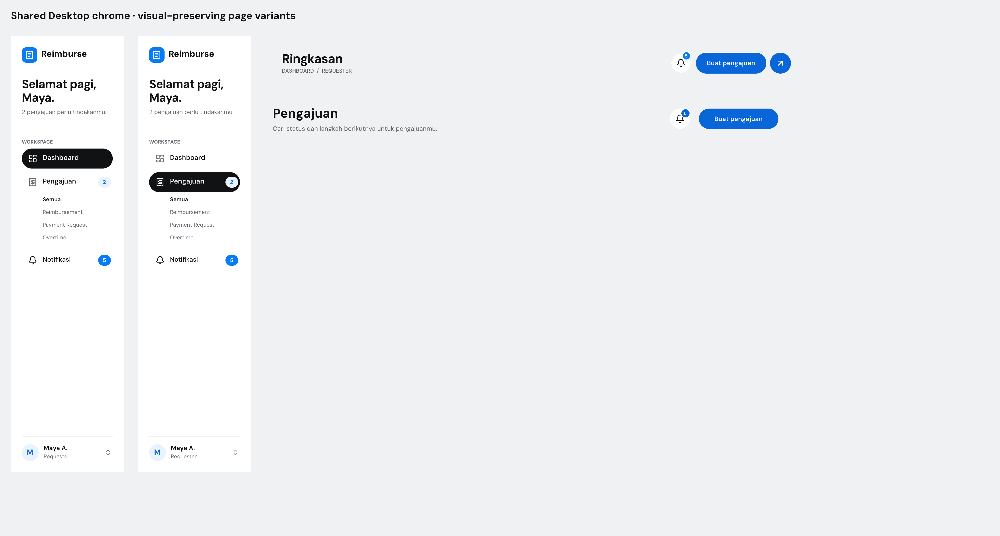
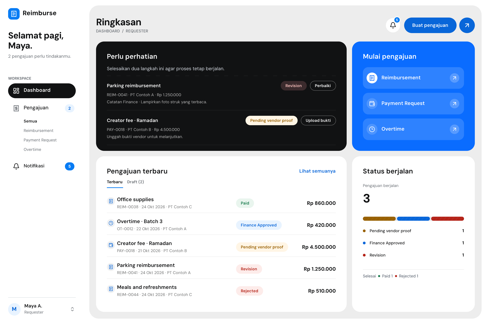
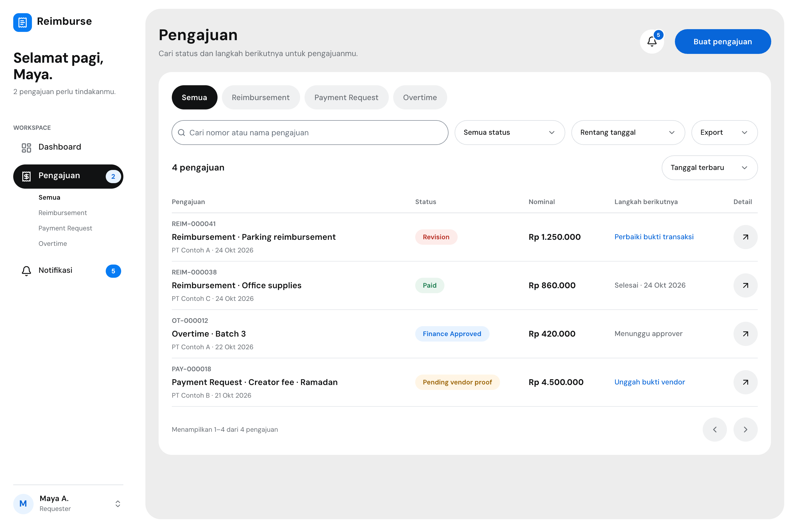

# Shared Desktop chrome: bukti tanpa regresi

Issue #7 / PR #8. Refactor struktur saja, bukan polish visual. Mobile belum dikerjakan; PR PG-04 tidak di-merge.

## Sumber reusable
- Board `C5b1W`: sumber dan preview halaman.
- Sidebar `TFVJz`: Dashboard/Pengajuan active melalui descendant overrides; state greeting/count, akses Wardrobe dan menu profil dipertahankan.
- Header `Igbr1`: Dashboard variant `P5kQ8L`, Pengajuan variant `cyhjq`. Satu sumber dengan dua susunan yang mempertahankan baseline masing-masing.
- 23 layar memakai masing-masing sumber: 10 Dashboard/state dan 13 PG-04 Desktop; dua preview pada board juga connected refs.
- Button `fFmN2`, search `NdxOT`, status `R5NHOj` dan sumber lama tidak diubah. Primary-button instance `xaXdi` milik header normal PG-04 tetap ada di dalam sumber; instance body yang sudah benar tidak diganti.

[PNG board penuh](C5b1W.png)

## Dashboard setelah ekstraksi
[PNG normal Dashboard, 2880 × 1920](j5omxK.png)

## PG-04 setelah ekstraksi
[PNG normal PG-04, 2880 × 1920](../pg04-desktop/k0okVa.png) · [Seluruh state](../pg04-desktop/README.md)

## Perbandingan regresi
[Laporan JSON per frame](regression.json) memuat SHA-256 sebelum/sesudah dan hasil byte comparison untuk seluruh 23 PNG 2×:

- **13/13 PG-04 byte-identik**: normal, filtered, no results, empty, loading, error, service disabled, status menu, date menu, export menu/generating/error/denied.
- **10/10 Dashboard byte-identik**: normal, service picker, Wardrobe permission, drafts, empty, loading, error, service disabled, stress, profile menu.
- **0 changed pixels** pada seluruh frame. Urutan header dipertahankan sebelum picker agar shadow/stacking juga identik.
- Ekspor ulang PG-04 ditulis ke lokasi PNG yang sama; karena byte-identik, Git tidak menampilkan binary diff palsu.
- File pembanding sementara berada di `/tmp/reimburse-chrome-before/` dan `/tmp/reimburse-chrome-after/`; hanya report dan bukti final yang masuk repo, bukan backup/versioned copy canvas.

## Verifikasi file tersimpan

- `design/reimburse.pen` memuat board `C5b1W`, kedua sumber reusable (`TFVJz`, `Igbr1`), dan tepat satu instance sidebar + header pada masing-masing 23 layar. Varian aktif dan state overrides diverifikasi dari JSON tersimpan, bukan hanya editor.
- **462 instance lama di luar chrome** tetap identik beserta ID/ref/propertinya. Original primary-button instance `xaXdi` juga tetap identik. Seluruh sumber komponen lama, variabel dan referensi PG-04 Mobile tidak berubah.
- Render final setelah Save juga **23/23 byte-identik** terhadap render sebelum ekstraksi; bounds inspection tidak menemukan masalah layout aktif.
- SHA-256 canvas pada ekstraksi shared-chrome: `8c933f9e4a7bba20dc4458862096dd0787442bb417300e87045c03545b250ff2`.

## Polish PG-04 berikutnya

Koreksi owner berikutnya hanya mengubah state Export generating, date popover dan service-disabled. Klaim 23/23 identik di atas khusus ekstraksi shared-chrome, bukan larangan atas tiga koreksi yang diminta. Sumber chrome tidak berubah; **20 render yang tidak ditargetkan tetap byte-identik**, termasuk seluruh 10 Dashboard/state. Lihat `latest_pg04_polish` pada [report](regression.json) dan [galeri terbaru](../pg04-desktop/README.md).

Penataan posisi frame serta dua label area lokal yang ada sebelum tugas dipertahankan. Tidak ada perubahan business rule, Foundation variables, tema, viewport atau Mobile. Ini bukti render statis, bukan verifikasi runtime/keyboard/screen reader.
