# PG-02 Mobile: render untuk review

Issue #5. Baseline Desktop: `113a418`, PR #4; dependensi transitif: bootstrap PR #2. Desain statis, bukan aplikasi berjalan. Polish pada issue/PR yang sama: keterangan `Data contoh · Requester` hanya di nama frame, badge `5` pada bell menggantikan helper header, dan menu profil memakai bottom sheet yang konsisten dengan picker layanan. Seluruh 15 viewport diterapkan; Foundations, sumber komponen lama, informasi bisnis dan pola scroll dipertahankan.

Setiap viewport berukuran 390 × 844, diekspor 2× menjadi **780 × 1688**. Gambar ditampilkan pada lebar 390 agar proporsi perangkat tetap; klik tautan PNG untuk melihat resolusi penuh. Overview hanya navigasi cepat, bukan bukti keterbacaan.

## Normal
[PNG resolusi penuh](JIPY2.png)

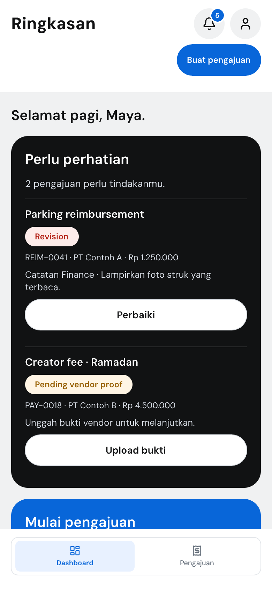

## Stress: 8 tugas perhatian
[PNG resolusi penuh](ZKFu6.png)

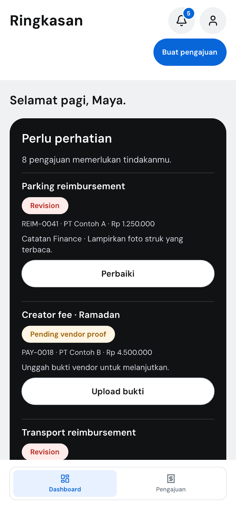

## Empty
[PNG resolusi penuh](r1eeyO.png)

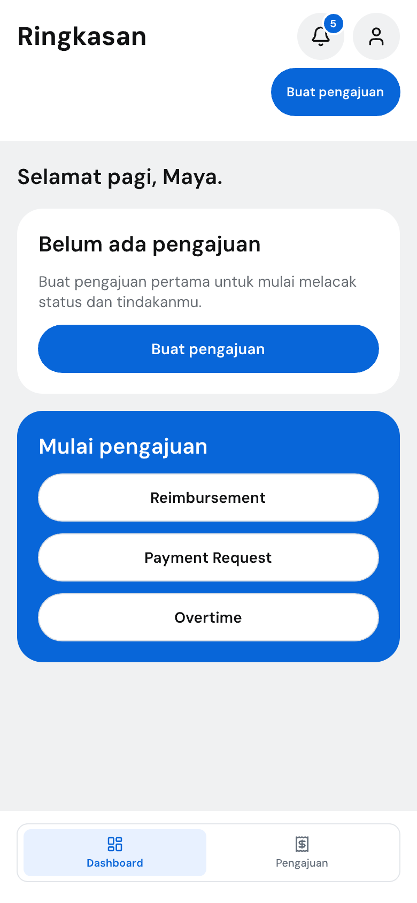

## Loading
[PNG resolusi penuh](xwfXZ.png)

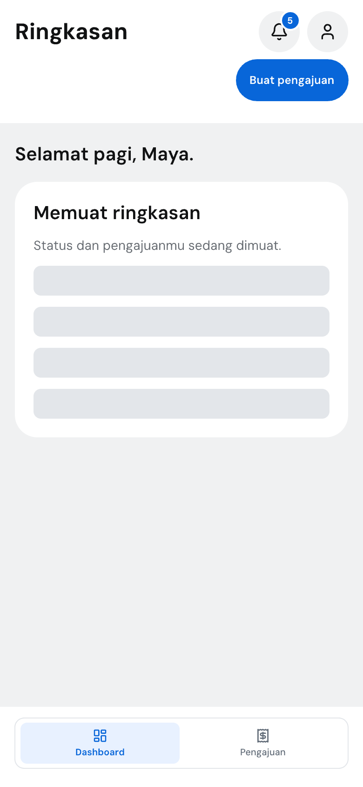

## Error
[PNG resolusi penuh](wH6eU.png)

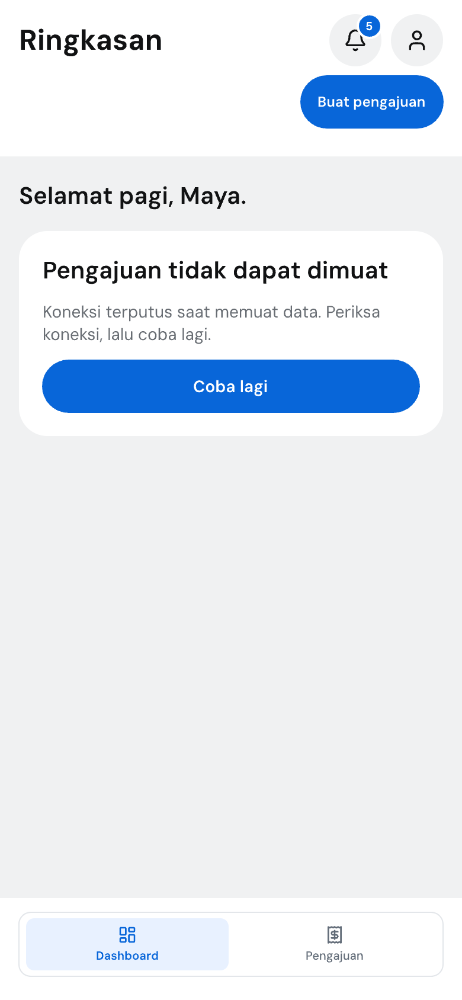

## Service disabled
[Viewport awal](ubUWJ.png) · [PNG layanan setelah scroll](Qyayp.png)

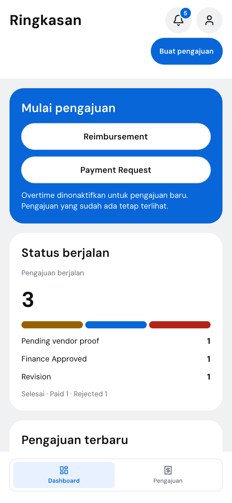

## Service picker terbuka
[PNG resolusi penuh](Dbjwn.png)

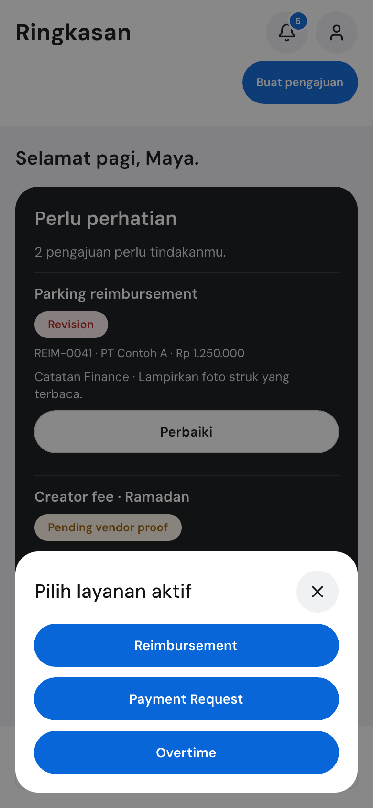

## Drafts
[Viewport awal](sKIid.png) · [PNG Draft setelah scroll](CjdB9.png)

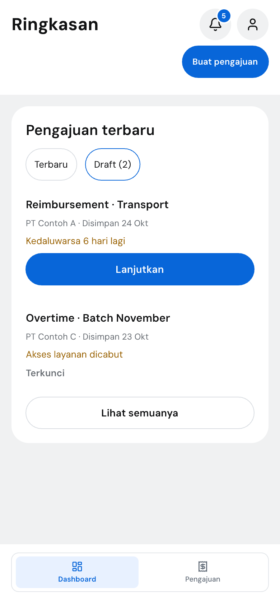

## Wardrobe permission
[PNG resolusi penuh](y8W79.png)

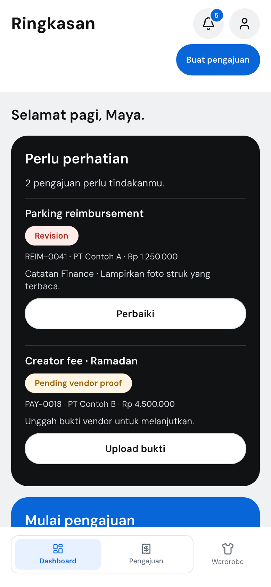

## Profile bottom sheet terbuka
[PNG resolusi penuh](u99Hlb.png)

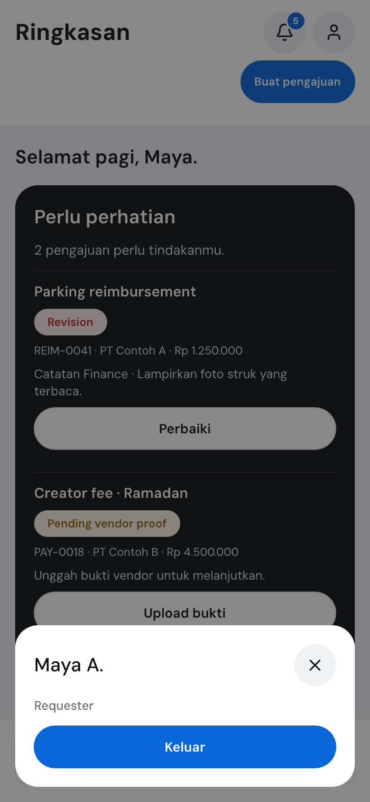

## Normal: status setelah scroll
[PNG resolusi penuh](cG46Q.png)

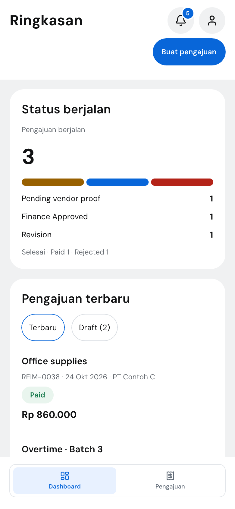

## Stress: status 5/4/3 setelah scroll
[PNG resolusi penuh](Od6Qd.png)

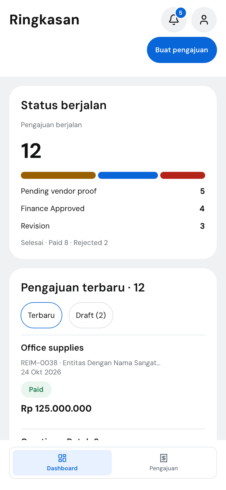

## Normal: akhir scroll
[PNG resolusi penuh](s24EP.png)

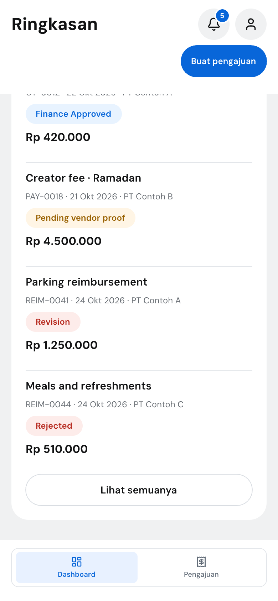

## Extent konten lengkap
- [Normal, 780 × 4170](cD8aK.png)
- [Stress, 780 × 4702](ktDJv.png)
- [Overview 10 state](review-overview.png)

Konten lengkap tetap terlihat di shared-source board `XyHpr`; viewport sengaja memotong konten vertikal. Spesimen setelah scroll memakai offset konten sumber yang sama. Scroll, klik, keyboard, focus trap, dan screen reader belum diimplementasikan atau diuji oleh canvas.

## Verifikasi finalisasi
- JSON tersimpan memuat seluruh 15 viewport dan 10 sumber reusable.
- Perbandingan rekursif terhadap `113a418`: seluruh node lama identik; tidak ada node lama dihapus; variabel identik.
- Stress: lebar warna 129.1667 / 103.3333 / 77.5 px dari area warna 310 px, tepat 5/12 / 4/12 / 3/12. Dua gap 4 px dipertahankan.
- Pemeriksaan bounds shared-source board tidak melaporkan masalah layout.
- PNG individual dirender ulang dari canvas tersimpan pada skala 2×.
- Verifikasi polish terhadap `342afca`: hanya 25 teks presentasi dihapus (10 disclosure konten + 15 helper header), 30 node badge ditambahkan, dan properti node lama hanya berubah pada nama frame, offset y, serta alignment baris CTA. Seluruh data bisnis dan sumber komponen tetap.
- Semua 15 viewport memiliki satu badge bell `5`, tanpa dua teks helper lama di UI. Setiap nama frame viewport memuat `Data contoh · Requester`.
- Picker (252 px) dan profil (170 px) sama-sama berakhir di y=828, inset 16 px dari bawah viewport 844 px. Offset spesimen scroll diperbarui sesuai extent yang berkurang 32 px; section tujuan tetap.
- SHA-256 `design/reimburse.pen`: `da17e7b60a92fcc3f1c8cdcdf996ca69c5f5407134b16ae16051279bbbed90dd`.
