# PG-04 Daftar Pengajuan: Desktop untuk review

Issue #7. Branch `design/pg04-request-list`, dari merged `main` `e5f7682`. Owner menyetujui Desktop pada commit `9bea1db` sebagai baseline; hasil visual Mobile terbaru juga disetujui owner sebagai baseline pada issue/PR yang sama. Tidak ada dark theme atau flow lanjutan.

Setiap PNG diekspor 2× dari viewport 1440 × 960 menjadi **2880 × 1920**. Klik gambar/tautan untuk ukuran penuh. Semua angka, identitas, Entity, tanggal dan nominal adalah **Data contoh**, ditandai pada nama frame di canvas, bukan helper text UI.

## Polish terkini untuk review

- [Export Memproses… satu baris](QFvHY.png): kontrol 148 × 44, label auto satu baris, chevron tetap ada.
- [Detail popover tanggal](ybrfg.png): field berlabel `Tanggal mulai` / `Tanggal akhir`, primary `Terapkan`, secondary `Hapus tanggal`.
- [Layanan nonaktif](my54M.png): tab dan filter sidebar Overtime tetap terlihat untuk mencari pengajuan lama. Hanya pilihan membuat pengajuan baru yang menghilangkan Overtime; picker nonaktif yang sudah ada tetap hanya Reimbursement / Payment Request.

Perubahan ini sengaja mengubah tiga state (`IVTFX`, `a2cZo`, `my54M`); 20 render lain identik dengan baseline shared-chrome. Sumber reusable/sidebar/header dan Dashboard tetap utuh.

## Normal
[k0okVa.png](k0okVa.png)

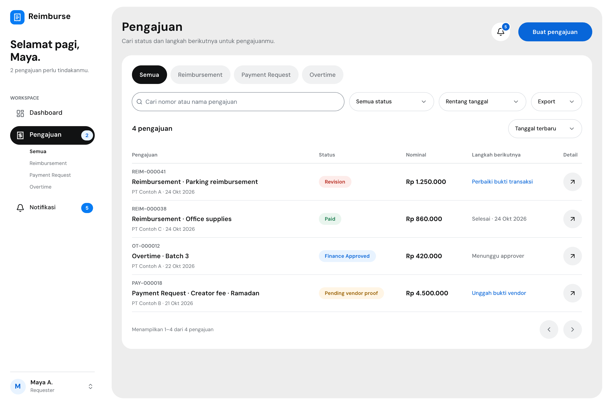

## Filtered: Payment Request + Pending vendor proof
[i2vM8K.png](i2vM8K.png)

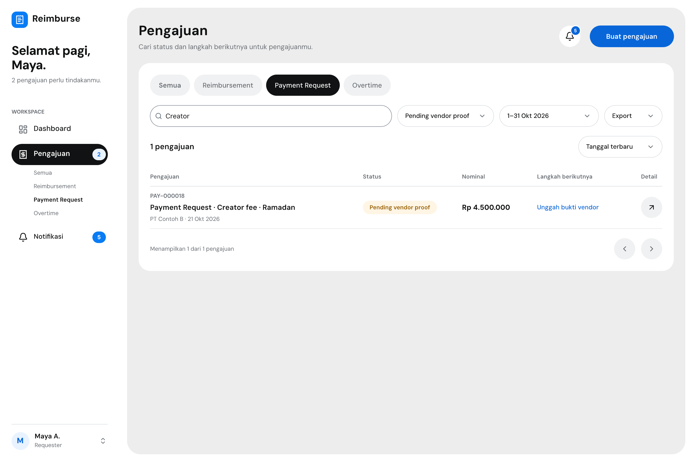

## No search results
[EyHtN.png](EyHtN.png)

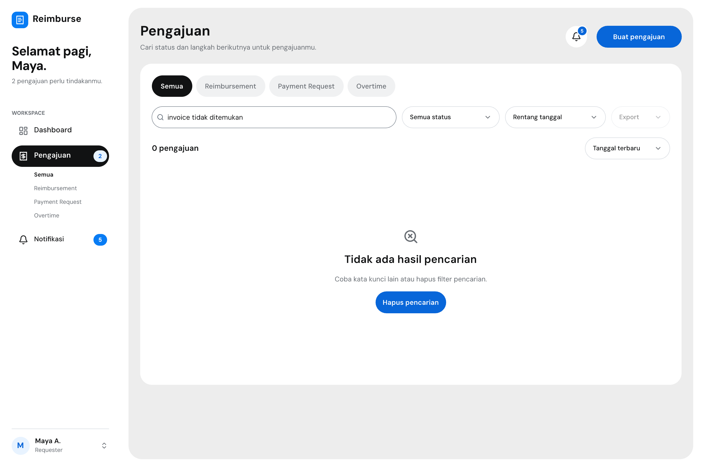

## Empty
[V3myh.png](V3myh.png)

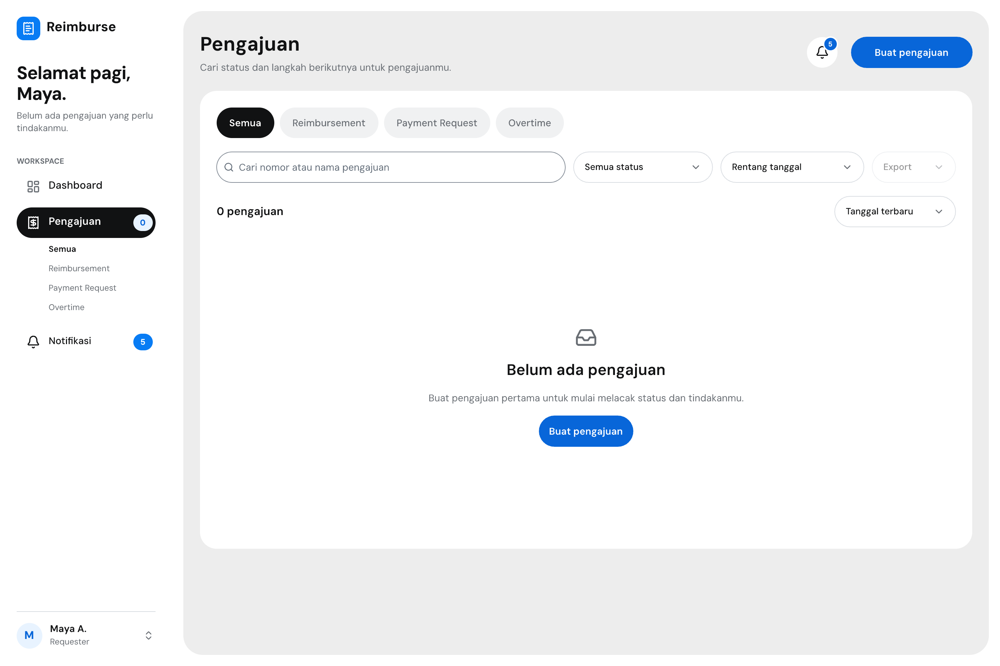

## Loading
[F65id0.png](F65id0.png)

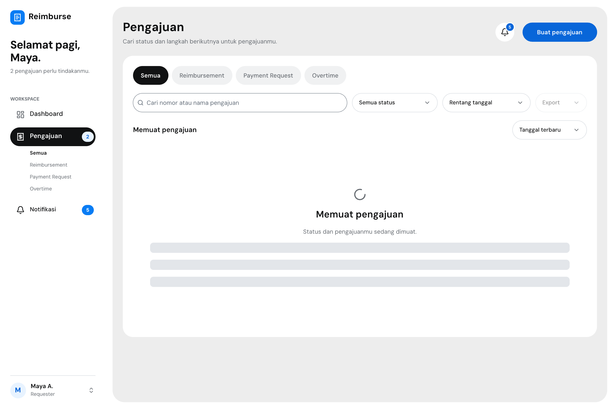

## Error
[T0RTci.png](T0RTci.png)

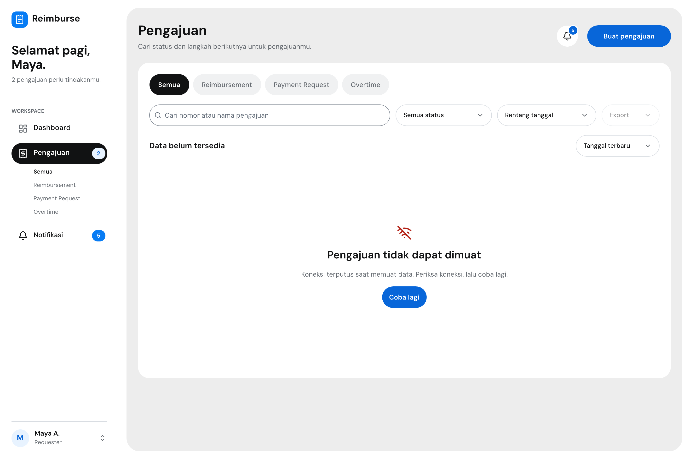

## Service disabled
[my54M.png](my54M.png)

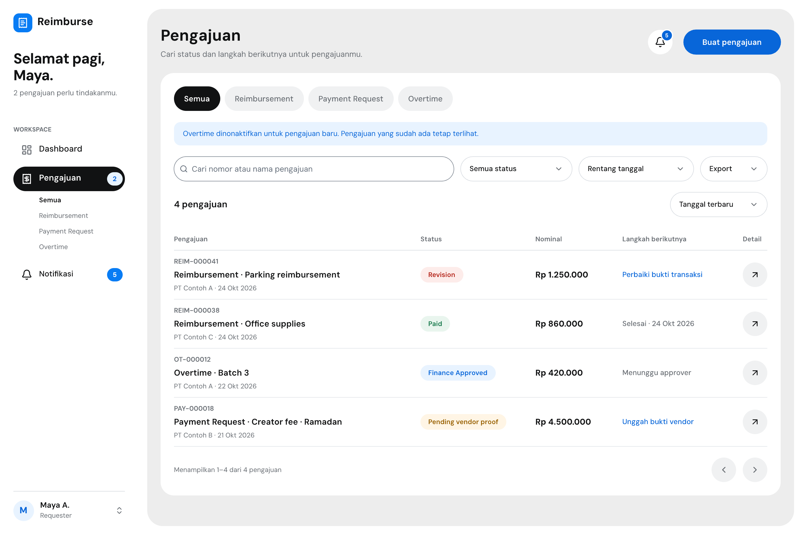

## Status filter open
[ORuMN.png](ORuMN.png)

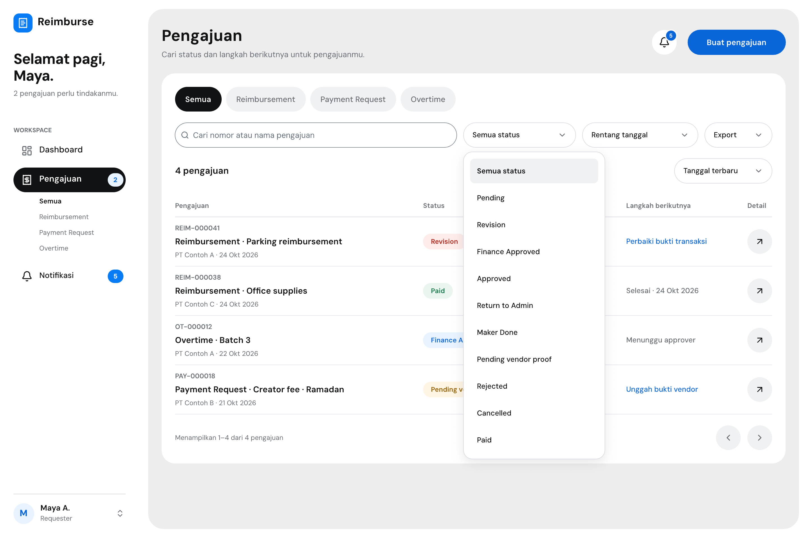

## Date filter open
[a2cZo.png](a2cZo.png)

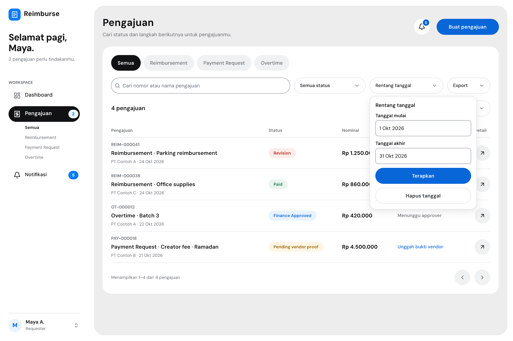

## Export menu open
[HKI9M.png](HKI9M.png)

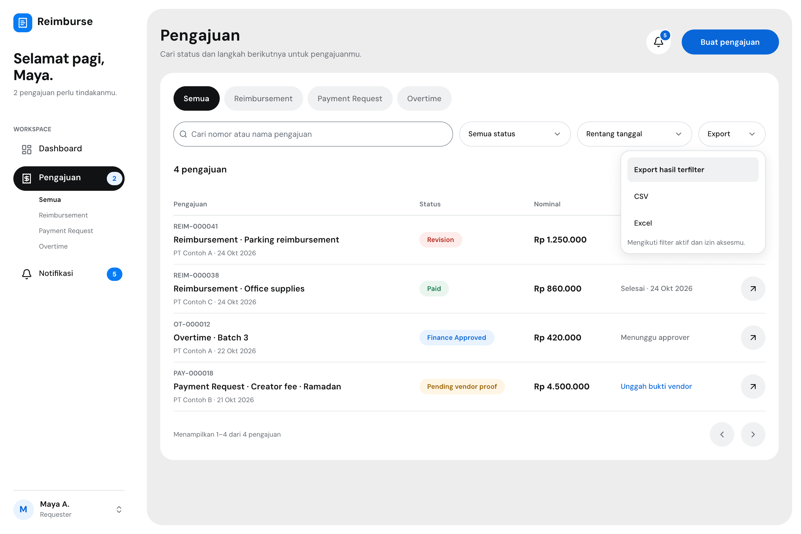

## Export generating
[IVTFX.png](IVTFX.png)

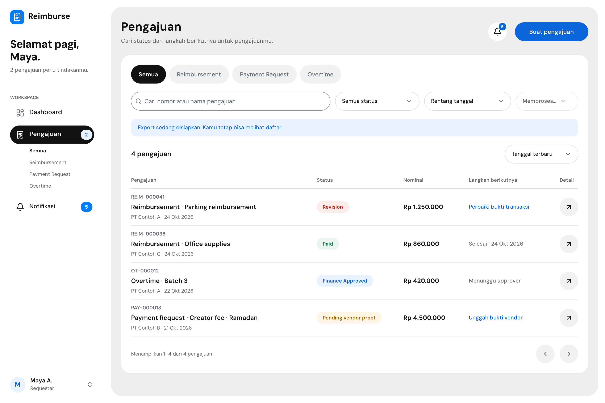

## Export error
[gFHa4.png](gFHa4.png)

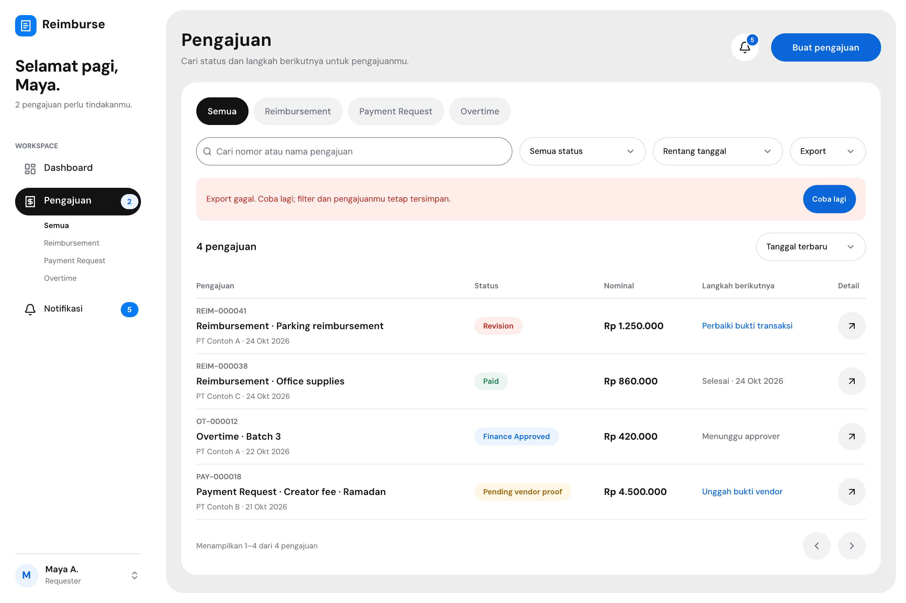

## Export denied
[it9Zo.png](it9Zo.png)

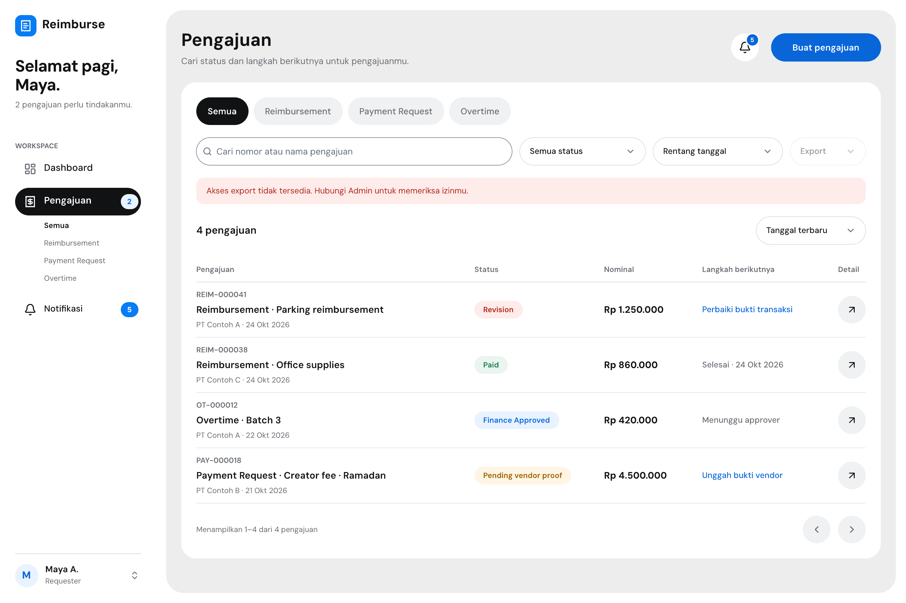

## Shared reusable chrome

Sidebar dan header kini memakai sumber bersama untuk Dashboard/Pengajuan: `TFVJz` dan `Igbr1`, dengan varian halaman aktif dan override state. Tidak ada perubahan visual: seluruh 13 render PG-04 serta 10 Dashboard/state pembanding byte-identik sebelum/sesudah ekstraksi.

[Bukti sumber reusable dan Dashboard](../desktop-chrome/README.md) · [Laporan perbandingan 23 frame](../desktop-chrome/regression.json).

## Dasar informasi dan aturan
- PRD v0.5: ownership/tenant, status workflow, perubahan akses layanan, pagination, FR-225–228 export mengikuti filter/permission.
- Layar lama `cmfPt` dan `UnqY7` tetap utuh. Empat nomor, judul/layanan, status, nominal dan next step dipertahankan; Entity/tanggal memakai fixture Dashboard yang disetujui. Urutan default: tanggal terbaru.
- Enam digit pada ID sampel lama dipertahankan sebagai fixture; bukan keputusan baru mengganti format PRD.
- `Pending vendor proof` hanya pada Payment Request. Revision ditindaklanjuti di detail/form terkait sesuai field yang dibuka; tidak ada pengubahan/cancel langsung dari daftar.
- Draft tetap di flow Dashboard/form, bukan status workflow baru. PDF tetap di detail; daftar menawarkan CSV/Excel. Tidak mendesain ulang PG-17.
- Requester hanya melihat pengajuannya sendiri dalam organisasi akun. Pengajuan lama, tab dan filter pencarian layanan tetap tersedia ketika layanan dinonaktifkan; hanya pilihan membuat pengajuan baru yang memakai daftar layanan aktif.

## Verifikasi dan batas bukti
- File canvas tersimpan memuat 13 frame Desktop 1440 × 960, rail Pengajuan aktif, sample disclosure di nama frame.
- Pada delivery awal, perbandingan JSON terhadap `main` `e5f7682` identik untuk semua node lama. Ekstraksi berikutnya mengubah struktur sidebar/header menjadi refs, bukan tampilan. Foundation, sumber komponen lama, konten bisnis dan referensi PG-04 Mobile tidak diubah; penataan posisi canvas lokal milik owner dipertahankan.
- Pemeriksaan bounds canvas: tidak ada masalah layout aktif. Skeleton/disabled export dan pagination satu halaman adalah spesimen statis, bukan perilaku yang sudah diimplementasikan.
- Render individual 2880 × 1920; tidak bergantung pada contact sheet kecil untuk review.
- `impeccable detect --json reimburse.pen` mengembalikan `[]`. Detektor tidak membuktikan semantik/aksesibilitas runtime.
- SHA-256 kandidat awal sebelum ekstraksi reusable: `f0be21f60eac9d44a5fdefecde398e688447e6d34dd6047e4807b580206bf5cc`. Identitas render terbaru diverifikasi per frame di `../desktop-chrome/regression.json`.
- Filter, pagination, aksi detail, export, permission enforcement, keyboard/focus dan pembaca layar belum diimplementasikan/diuji. Tidak ada app code, API atau workflow baru.

**Gate terbaru:** Desktop dan visual Mobile sudah disetujui owner sebagai baseline. [Render Mobile](../pg04-mobile/README.md) menggunakan viewport tetap dan spesimen scroll vertikal. Jangan merge PR PG-04 atau lanjut flow lain.
