# PG-04 Mobile: kandidat untuk review

Issue #7 / PR #8. Owner menyetujui Desktop commit `9bea1db` dan hasil visual Mobile terbaru sebagai baseline; persetujuan visual bukan izin merge atau bukti runtime. Semua viewport 390 × 844, diekspor 2× menjadi **780 × 1688**; klik tautan untuk gambar penuh. Nama, nomor, Entity, tanggal dan nominal adalah **Data contoh**, ditandai pada nama frame/handoff.

## Review polish filter terpadu

[Toolbar ringkas](jSSv3.png) · [Tiga filter aktif](SVqzr.png) · [Satu chip dihapus](QU1de.png) · [Sheet filter, posisi awal](WXk4E.png) · [Pilihan aktif](MR7e2.png) · [Tanggal setelah scroll](dRKeV.png) · [Detail jarak field tanggal](OPcBq.png).

Sepuluh content states memakai sumber toolbar `ruMUp`: **Filter + jumlah aktif** dan **Urutkan**. Layanan/status/tanggal berada dalam satu sheet reusable `LvtoT`; chip filter memakai `xkwe5` dengan target hapus 44 px. Pencarian tetap terpisah dan tidak dihitung sebagai filter. Tiga chip pada contoh filtered mempertahankan Payment Request, Pending vendor proof dan 1–31 Okt 2026; spesimen setelah satu chip dihapus menunjukkan count 2.

Konten sheet scroll vertikal dalam viewport 532 px; header dan footer tetap terlihat. `Hapus tanggal` berada di grup Tanggal dalam konten scroll, bukan di footer saat memilih layanan/status. Footer hanya `Terapkan` dan `Hapus filter`. Jarak antarfield tanggal **16 px**, antaraksi footer **8 px**. `Hapus tanggal` hanya membersihkan tanggal; `Hapus filter` membersihkan semua filter; `Terapkan` menerapkan pilihan. Status dan layanan tetap mencakup semua pilihan, termasuk Overtime historis ketika layanan dinonaktifkan. Bukti ini statis; scroll dan penghapusan chip belum runtime.

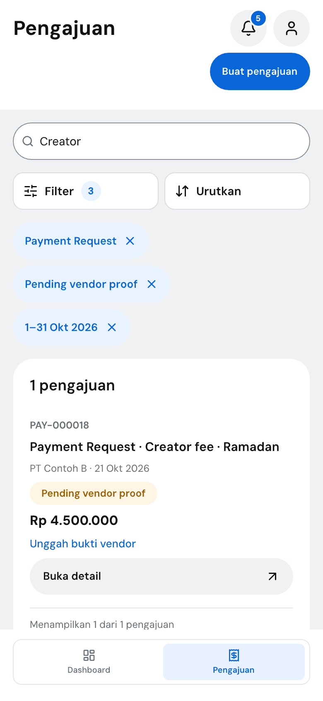 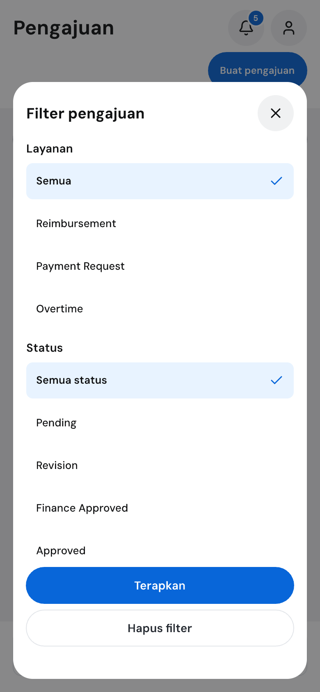 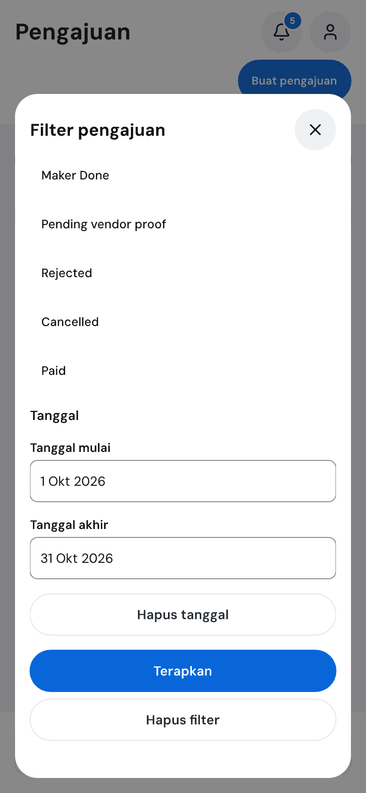

## Normal dan scroll
[Normal awal](jSSv3.png) · [Daftar setelah scroll](J3IVxP.png) · [Akhir daftar, pagination dan Export](MyyEK.png) · [Konten normal lengkap 780×2800](rFEiu.png)

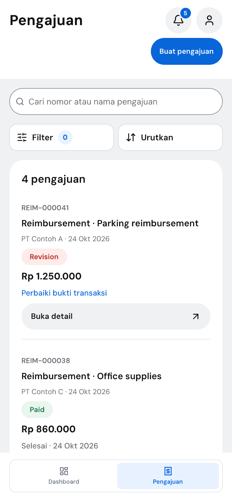 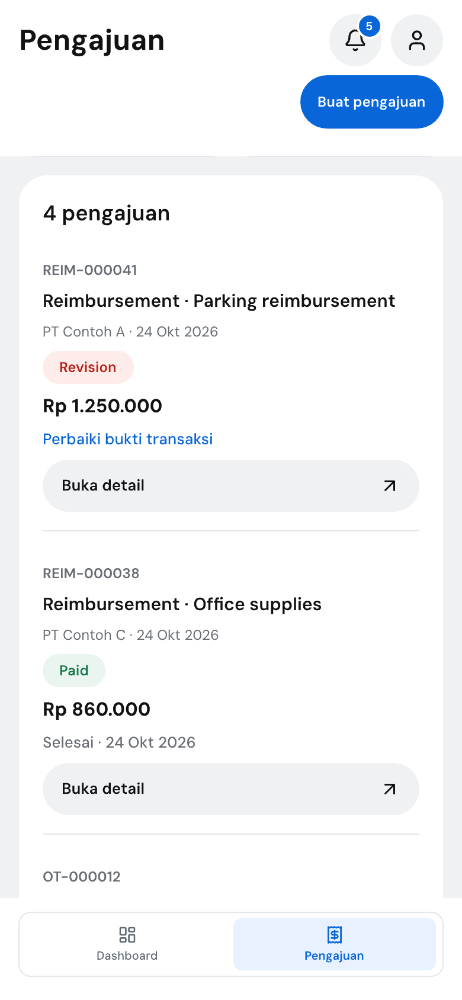 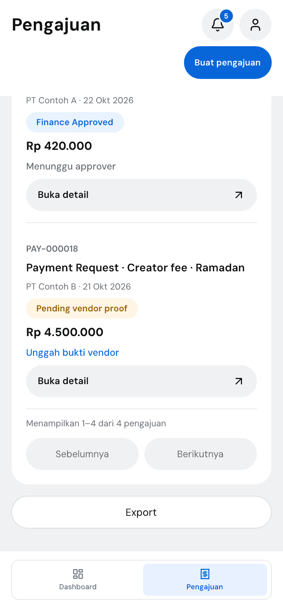

## Filter dan hasil
[Filtered awal](SVqzr.png) · [Filtered setelah scroll](P5aoJ.png) · [No results](g29tW.png) · [Empty](iKaGO.png) · [Loading](woVE2.png) · [Error](kZoBb.png)

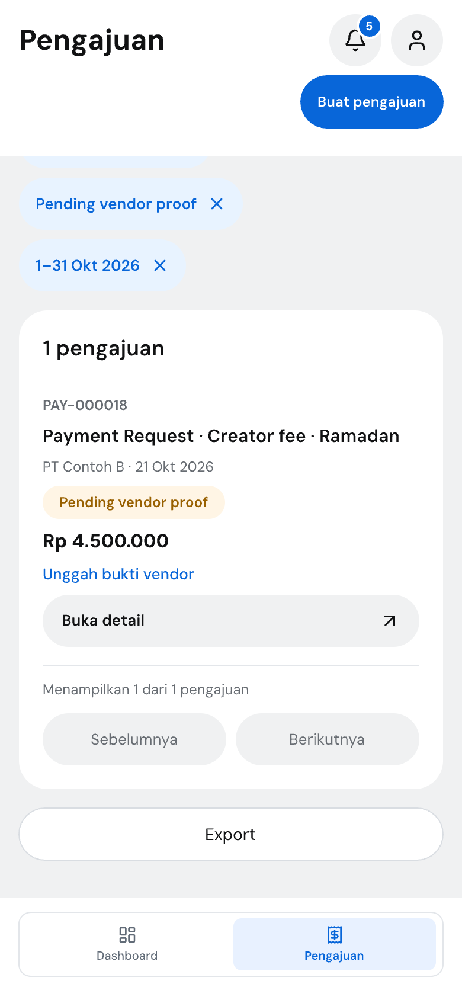 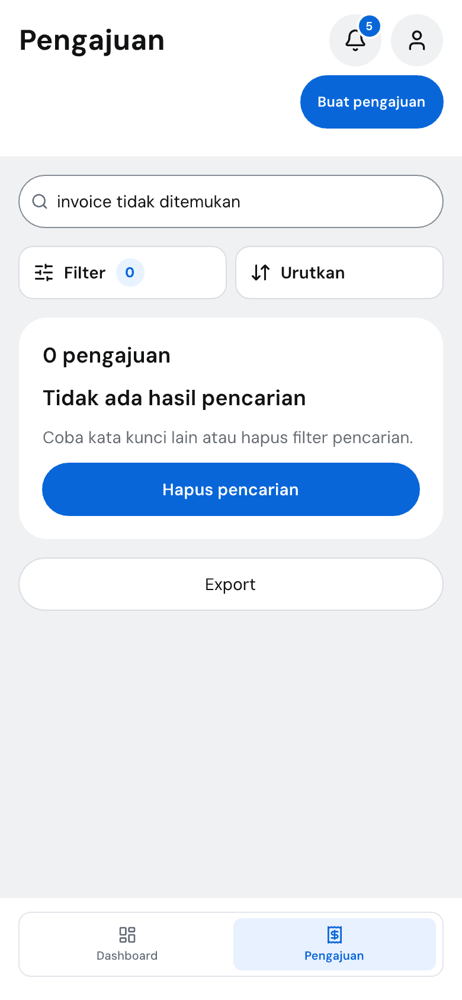 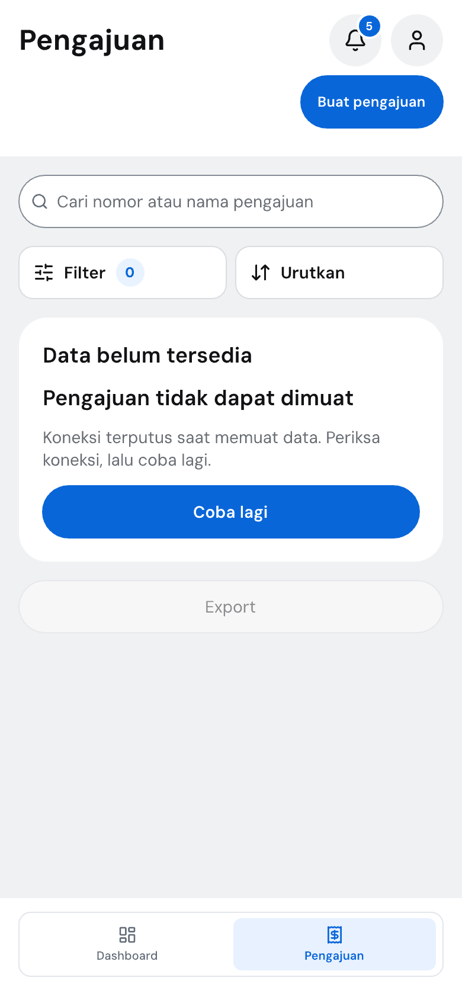

## Bottom sheets
[Filter terpadu: layanan](WXk4E.png) · [filter terpadu: status](bUJ52.png) · [filter terpadu: tanggal setelah scroll](dRKeV.png) · [Urutkan](ugfAV.png) · [Export CSV/Excel](oeHMy.png)

 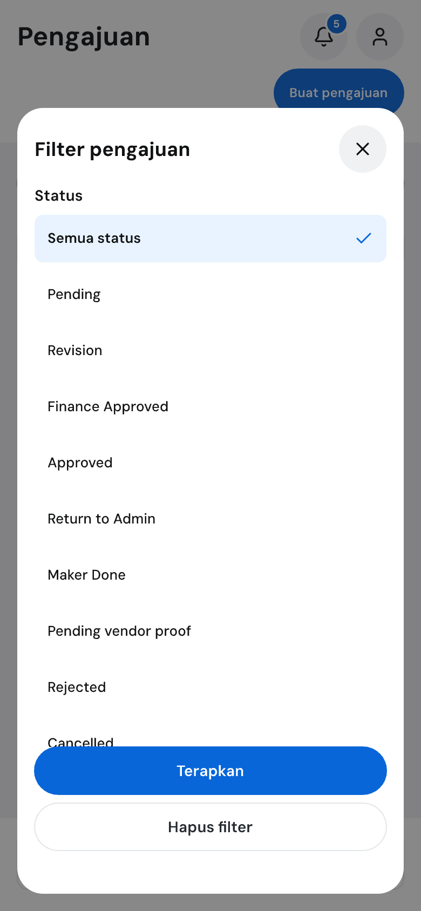 

## Layanan dinonaktifkan
[Awal](NSu34.png) · [Filter layanan tetap memuat Overtime](IHevC.png) · [Pengajuan Overtime lama setelah scroll](c8p1s.png) · [Picker pengajuan baru hanya layanan aktif](MJZ0k.png) · [Konten lengkap 780×2952](QRtPs.png)

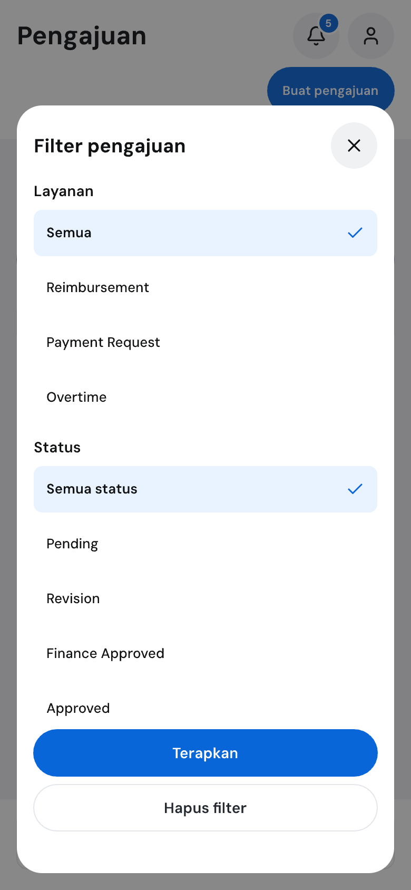 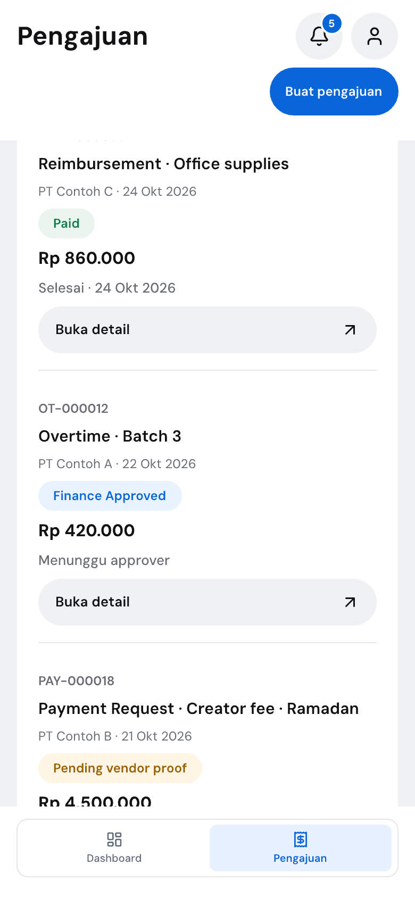 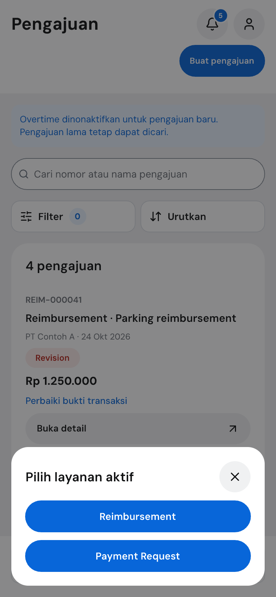

## Export states
[Generating awal](sIy5S.png) · [Generating setelah scroll](dktSx.png) · [Error awal](EEKmt.png) · [Error setelah scroll](LP79A.png) · [Denied awal](ACAdA.png) · [Denied setelah scroll](n0arg.png)

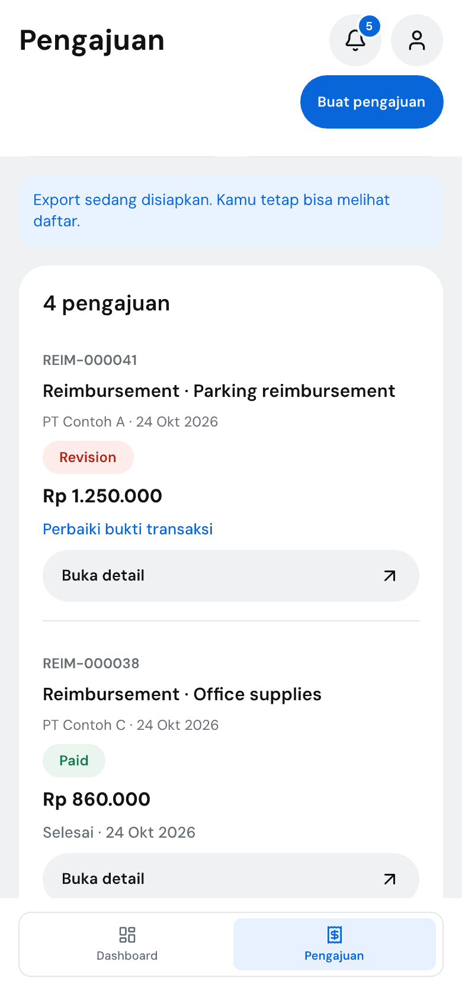 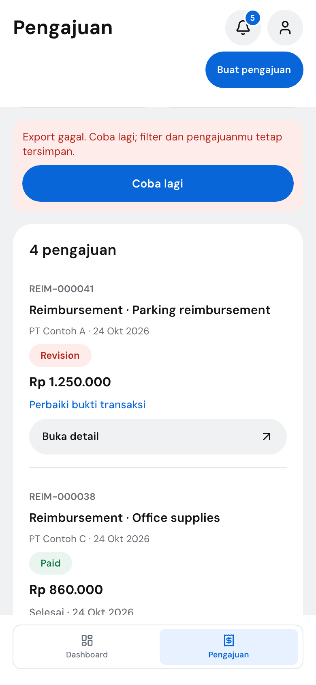 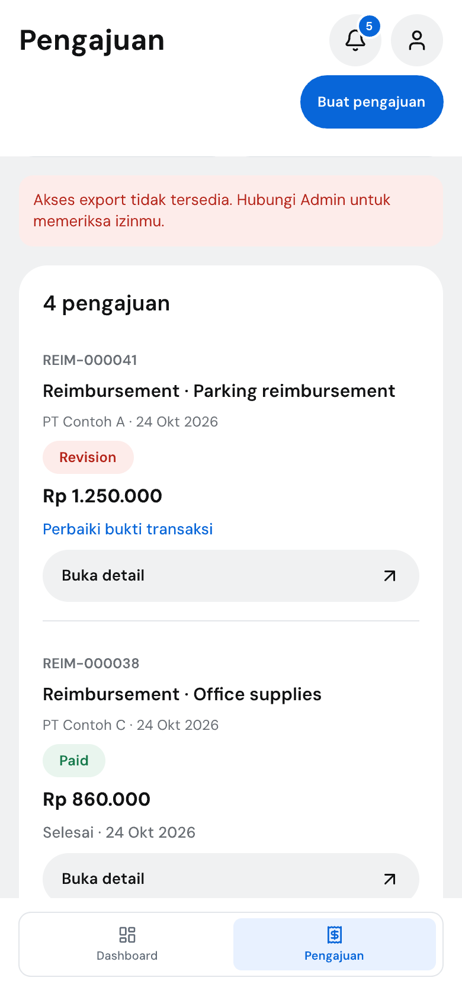

## Verifikasi
- File `design/reimburse.pen` tersimpan memiliki **27 viewport Mobile 390×844**, 10 reusable content sources, reusable row `jzecl`, toolbar `ruMUp`, chip `xkwe5`, dan sheet `LvtoT`; masing-masing viewport memakai navigasi `IenEv` aktif.
- JSON rekursif terhadap Desktop-approved `9bea1db`: semua node lama dan variabel identik. Render PG-04 Desktop dan Dashboard Desktop juga byte-identik dengan baseline.
- Row instances mempertahankan nomor, judul/layanan, Entity/tanggal, status, nominal, next step dan target detail 44 px. Filter layanan/status/tanggal, urutan dan pagination tersedia dalam desain.
- Bounds shared-source board tidak melaporkan masalah. Clipping vertikal viewport/sheet status sengaja menggambarkan scroll; specimen offset dan konten lengkap disertakan.
- State layanan nonaktif tetap menyajikan filter dan pengajuan Overtime lama; picker create hanya layanan aktif.
- SHA-256 canvas tersimpan setelah polish: `88e131e296d8963a7873fe6fadee902afb9c366255326a29aa1a2c41c158d6b4`. Sepuluh state memakai toolbar reusable; footer sheet hanya `Terapkan` dan `Hapus filter`; `Hapus tanggal` berada di grup tanggal dalam scroll. Verifikasi jarak 16/8 px dan chip-count/removal pada JSON tersimpan lulus.

**Batas bukti:** seluruh layar adalah desain statis. Scroll, pencarian, filter, export, akses detail, permission enforcement, keyboard/focus dan screen reader belum diimplementasikan/diuji. Tidak merge atau melanjutkan flow lain.
